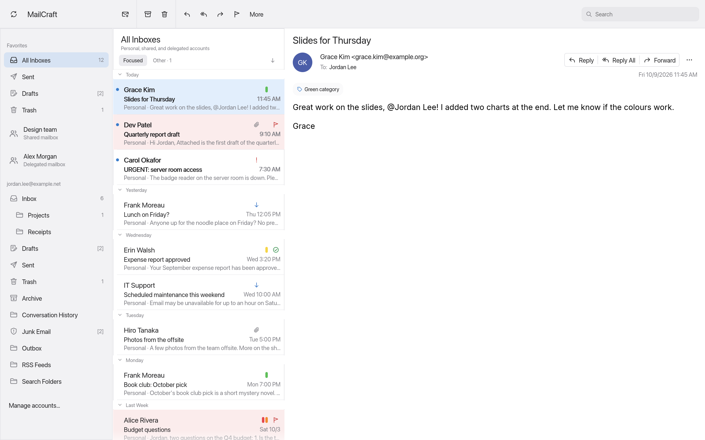
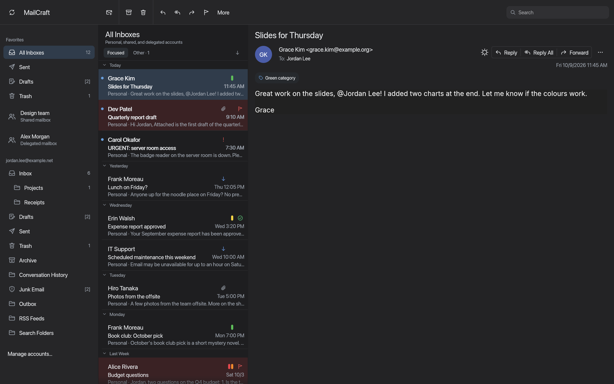
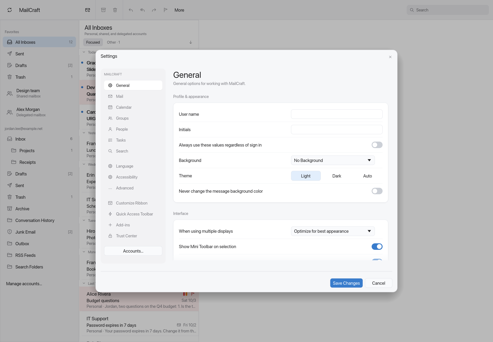
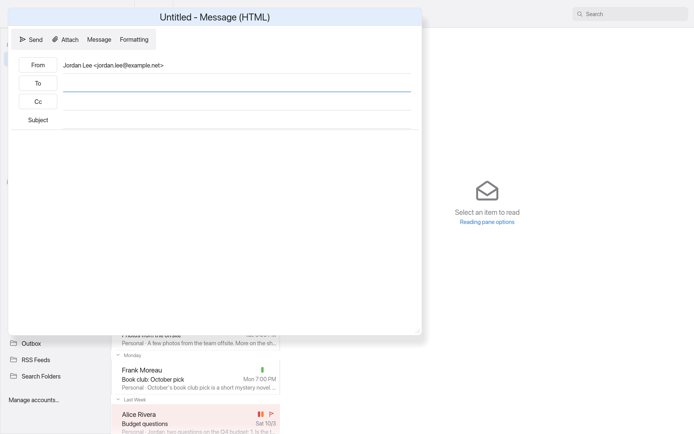
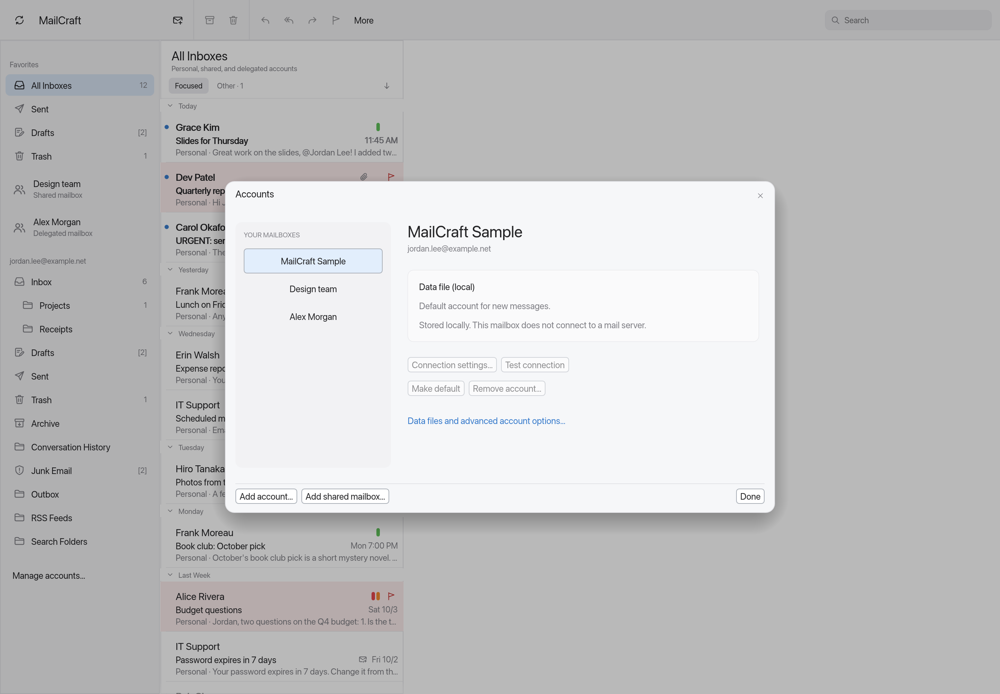

<h1 align="center">MailCraft Mac</h1>

<p align="center">
  
</p>

<p align="center"><b>A quieter Mac mail app, with room for all your mailboxes.</b></p>

<p align="center">
  A Mac-focused fork of <a href="https://github.com/MonkeySaint/mailcraft">MailCraft</a>.
  A compact toolbar, a unified inbox, and a refined light and dark interface over a local-first Rust mail engine.
  Built for personal mail alongside shared and delegated accounts.
</p>

<p align="center">
  <a href="#a-look-inside">Screenshots</a> ·
  <a href="#what-works-today">Features</a> ·
  <a href="#shared-and-delegated-mailboxes">Shared mailboxes</a> ·
  <a href="#run-on-your-mac">Run on your Mac</a> ·
  <a href="#development">Development</a>
</p>



All Inboxes brings personal, shared, and delegated Inbox folders into one view. Screenshots show the current Mac interface with synthetic demo mail; no real accounts or messages are shown. These are offscreen app renders, so the operating system's window controls are not included.

## A look inside

| Light and dark | Settings and accounts |
|---|---|
|  |  |
| Muted accents, compact date markers, and a quiet toolbar. | Layered settings cards, refined controls, and consistent spacing. |
|  |  |
| Sender identity stays visible; rich formatting is available when needed. | Personal and linked mailboxes in a dedicated account manager. |

## What is different in this fork

- **Mac comes first.** The desktop app opens the Mac shell: unified title bar, compact actions, softer icons, and system font loading on macOS. The UI is built with Rust and egui; it is not a SwiftUI app.
- **One combined inbox.** All Inboxes aggregates Inbox folders and unread counts. Search stays within those inboxes, and message actions keep the source mailbox identity.
- **Space for shared work.** Shared and delegated mailboxes have distinct sidebar labels, their own authorization, and explicit sending permissions in the client.
- **More considered details.** A refined search field, compact Focused/Other controls, lighter date groups, a new original envelope icon, and redesigned settings and account layouts.

The underlying mail engine, CLI, and MCP integration come from upstream. This fork changes the desktop experience and adds unified-inbox and linked-mailbox behavior. The web front end and default headless UI retain the classic shell.

## What works today

**Pre-alpha.** The Mac interface and linked-account implementation are under active development.

| Area | Available now |
|---|---|
| Inbox | Combined Inbox folders, per-account folders, unread counts, Focused/Other, date grouping, sorting, filtering, and search |
| Mail | Reading pane, replies, forwarding, drafts, archive, delete, move/copy, flags, categories, and conversations |
| Compose | Visible From identity, compact actions, rich text, spelling, signatures, address completion, and attachments |
| Accounts | Existing IMAP/SMTP, POP3, JMAP, OAuth flows, local storage, and background sync; shared/delegated OAuth IMAP setup |
| Settings | Category navigation, grouped forms, appearance selection, Save/Cancel, and a separate account manager |
| Other tools | Existing rules, quick steps, calendar, people, tasks, notes, import/export, print/PDF, CLI, and MCP |

See [Mac setup and limitations](docs/mac.md), [account documentation](docs/accounts.md), and the [fork roadmap](ROADMAP.md). The inherited [feature catalog](docs/parity.md) measures command coverage, not complete Outlook compatibility.

## Shared and delegated mailboxes

Linked Microsoft 365 mailboxes currently use **OAuth IMAP/SMTP**. Each mailbox signs in separately as the delegate using a configured public-client app registration. Receive-only is the default; Send As is opt-in and requires server-side permission. A receive-only mailbox cannot silently send through your personal account.

This has been tested with synthetic/local fixtures, **not a real Microsoft 365 tenant**. Graph/EWS, automatic mailbox discovery, permission administration, Send on Behalf, and shared Exchange calendars are not implemented. Organizations that disable IMAP/SMTP need a different transport. This is not yet a replacement for all Outlook account capabilities.

Follow the [linked-mailbox setup guide](docs/mac.md#shared-and-delegated-microsoft-365-mailboxes) for the exact flow and limits.

## Run on your Mac

Install a Rust toolchain compatible with the workspace, then:

```sh
git clone https://github.com/samcapshaw/amailcraft.git
cd amailcraft

# In-memory demo with personal, shared, and delegated sample mail
./scripts/run-mac.sh --sample

# Persistent local profile
./scripts/run-mac.sh

# Build a local development app bundle
./scripts/package-local-mac.sh
```

The bundle is created at `dist/MailCraft Mac.app`. It is a local development build for the build machine's architecture, without distribution signing or notarization. No signed Mac release is promised by the inherited upstream tags.

The default Mac profile is `~/Library/Application Support/MailCraft Mac`; `--profile PATH` opens a separate profile. The bundle identifier is `dev.mailcraft.mac`. Demo accounts cannot connect or send. OAuth requires your own provider app registration; see [account setup](docs/accounts.md).

## Development

User-visible actions dispatch through the engine's command registry. The Mac shell lives in `crates/ui-egui/src/mac.rs`; the desktop host enables it with `App::enable_mac_style()`.

```sh
mkdir -p target/tmp
export TMPDIR="$PWD/target/tmp"
export CARGO_BUILD_JOBS=4

cargo test -p mailcraft-engine -p mailcraft-ui-egui --lib
cargo clippy -p mailcraft -p mailcraft-ui-egui -p mailcraft-engine --all-targets -- -D warnings
cargo xtask ci

# Refresh the README screenshots from the synthetic Mac demo
./scripts/screenshots-mac.sh
```

| Layer | Crates | Responsibility |
|---|---|---|
| Model and content | `geom`, `mime`, `model`, `fonts` | Mail data, MIME, geometry, and bundled open fonts |
| Storage and rendering | `store`, `html`, `layout`, `render` | Local persistence, sanitizing, layout, and raster/PDF output |
| Services | `net`, `formats`, `proof`, `search` | Protocols, file formats, spelling, and indexed search |
| Application | `engine` | Commands, account routing, sync, session, and undo |
| Interfaces | `ui-egui`, `mcp`, desktop/CLI/web apps | Mac desktop shell, classic host UI, automation, and entry points |

Apple fonts are loaded from the installed operating system and are not redistributed. The app icon is original vector artwork. Use synthetic mail and local test servers for development.

Automation: [CLI and MCP](docs/mcp.md) · [Local control channel](docs/control-protocol.md).
Distribution: [Build and release notes](docs/releasing.md).
Contributions: [pull requests for this fork](https://github.com/samcapshaw/amailcraft/pulls).

## Upstream and license

This fork is based on [MonkeySaint/mailcraft](https://github.com/MonkeySaint/mailcraft). Credit for the Rust mail engine, original application, and inherited tools belongs to the upstream contributors. Historical upstream milestones remain documented in the [roadmap](ROADMAP.md#upstream-history).

MIT OR Apache-2.0 ([LICENSE-MIT](LICENSE-MIT), [LICENSE-APACHE](LICENSE-APACHE)). Third-party notices and asset credits are preserved in [NOTICE](NOTICE) and [ATTRIBUTION.md](ATTRIBUTION.md).

MailCraft Mac is independent and is not affiliated with or endorsed by Apple or Microsoft. Outlook is a Microsoft trademark, referenced only to describe compatibility goals.
