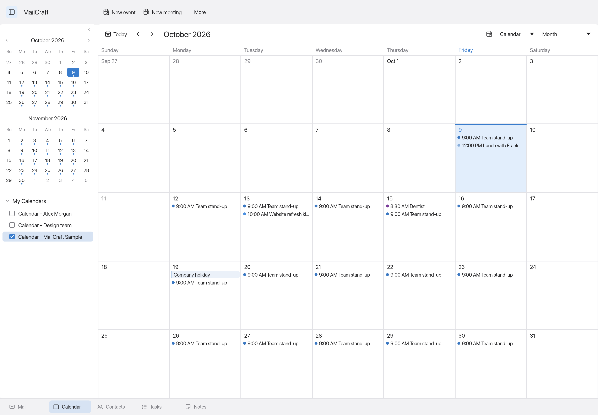
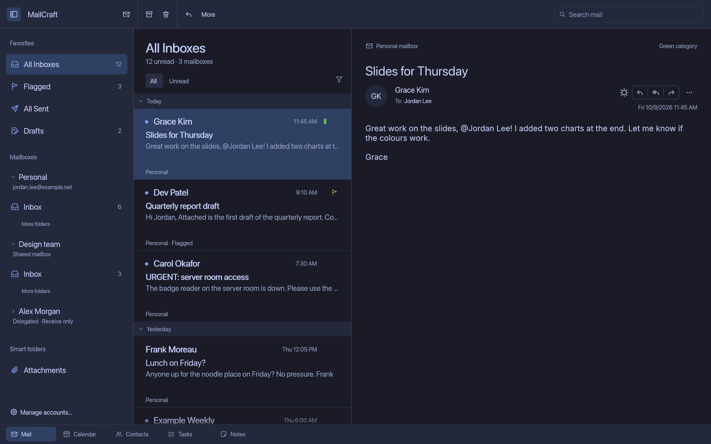
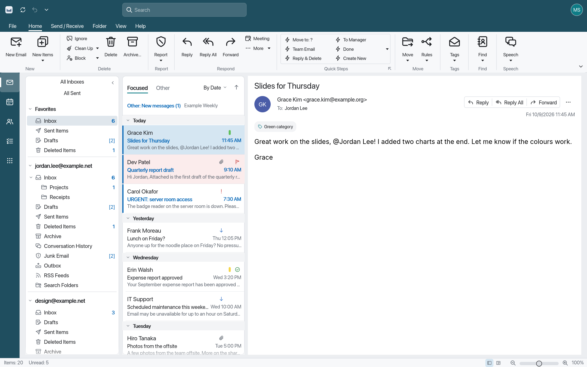

<h1 align="center">MailCraft</h1>

<p align="center">
  
</p>

<p align="center"><b>Your mail, your workspace, your style.</b></p>

<p align="center"><a href="https://github.com/samcapshaw/amailcraft/releases">Preview downloads for Windows, macOS and Linux</a></p>

<p align="center">
  A multi-style desktop fork of <a href="https://github.com/MonkeySaint/mailcraft">MailCraft</a>.
  A compact toolbar, a unified inbox, and a refined light and dark interface over a local-first Rust mail engine.
  Built for personal mail alongside shared and delegated accounts.
</p>

<p align="center">
  <a href="#a-look-inside">Screenshots</a> ·
  <a href="#what-works-today">Features</a> ·
  <a href="#shared-and-delegated-mailboxes">Shared mailboxes</a> ·
  <a href="#run-on-your-mac">Run on your Mac</a> ·
  <a href="#development">Development</a>
</p>


All Inboxes brings personal, shared, and delegated Inbox folders into one view. Screenshots show the current Mac interface with synthetic demo mail; no real accounts or messages are shown. These are offscreen app renders, so the operating system's window controls are not included.

## A look inside

**Latest update:** [Saved CalDAV calendars, offline access, automatic refresh, and connection recovery](docs/update-2026-10-15.md).

The downloadable 0.2.0-alpha.1 preview predates these calendar updates; build the latest source to try them.

| Light and dark | Settings and accounts |
|---|---|
|  |  |
| Charcoal surfaces, refined message rows, and a desktop layout with a collapsible sidebar and reader on the right. | Layered settings cards, refined controls, and consistent spacing. |
|  |  |
| Visible sender and signature picker, with a slim formatting bar when needed. | Personal and linked mailboxes in a dedicated account manager. |



Calendar, Contacts, Tasks, and Notes stay one click away in the compact navigation bar. Calendar includes day, week, month, and schedule views, event and meeting editors, reminders, and the existing iCalendar tools. Graph accounts can also display opt-in read-only Microsoft 365 calendars and default contacts, including linked mailboxes when server permissions allow. Selected event/contact edits and attendee responses are available through an optional Graph editing grant.

## What is different in this fork

- **Mac comes first.** The desktop app opens the Mac shell: unified title bar, compact actions, softer icons, and system font loading on macOS. The UI is built with Rust and egui; it is not a SwiftUI app.
- **One combined inbox.** All Inboxes aggregates Inbox folders and unread counts. Search stays within those inboxes, and message actions keep the source mailbox identity.
- **Space for shared work.** Shared and delegated mailboxes have distinct sidebar labels, their own authorization, and explicit sending permissions in the client.
- **More considered details.** A refined search field, compact Focused/Other controls, lighter date groups, a new original envelope icon, and redesigned settings and account layouts.

The underlying mail engine, CLI, and MCP integration come from upstream. This fork changes the desktop experience and adds unified-inbox and linked-mailbox behavior. The web front end and default headless UI retain the classic shell.

## What works today

**Pre-alpha.** The Mac interface and linked-account implementation are under active development.

| Area | Available now |
|---|---|
| Inbox | Combined Inbox and Sent folders, per-account folders, unread counts, Focused/Other, date grouping, sorting, filtering, and search |
| Mail | Reading pane, replies, forwarding, drafts, archive, delete, move/copy, flags, categories, and conversations |
| Compose | Visible From identity and signature picker, compact formatting, spelling, address completion, and attachments |
| Accounts | Existing IMAP/SMTP, POP3, JMAP, OAuth flows, local storage, and background sync; shared/delegated OAuth IMAP setup and an initial Microsoft 365 Graph mail transport with resumable downloads |
| Settings | Category navigation, grouped forms, appearance selection, Save/Cancel, and a separate account manager |
| Calendar and organizer | Persistent Calendar, Contacts, Tasks, and Notes navigation; local editing plus opt-in Microsoft 365 calendars/default contacts, single appointment creation/deletion and meeting invitations, selected server-confirmed edits and attendee responses |
| Other tools | Existing rules, quick steps, import/export, print/PDF, CLI, and MCP |

CalDAV calendars can be discovered, saved and refreshed manually or automatically into read-only offline snapshots (90 days back, one year ahead). See [CalDAV calendars](docs/caldav.md) for provider and recurrence limits.

See [Mac setup and limitations](docs/mac.md), [account documentation](docs/accounts.md), and the [fork roadmap](ROADMAP.md). The inherited [feature catalog](docs/parity.md) measures command coverage, not complete feature compatibility.

## Choose your interface

Open **Settings → Appearance → Make it yours** and choose a saved profile:

- **Apple styled** — our compact toolbar, quiet light/dark surfaces, collapsible mailboxes and right-hand reader.
- **PC layout** — the inherited ribbon, folder pane and classic navigation, using MailCraft's original artwork.
- **Omarchy** — the compact layout with Tokyo Night navy surfaces, blue selection, lavender details and softer text; a light variant is included. An optional **Follow Omarchy theme** setting reads your machine’s active palette.

| Omarchy · Tokyo Night | PC layout |
|---|---|
|  |  |

Light, Dark and Auto are independent of the layout. **Customize this palette** adds color pickers and RGB hex fields for accent, background, surfaces and text, with a preview. Save Changes applies the profile without a restart; Cancel discards edits. Custom colors use a fixed palette until switched off. Settings stay accessible in every layout.

The same chooser runs on Linux. On your Omarchy machine, build using the existing Linux instructions, then launch once with:

```sh
cargo run -p mailcraft -- --interface omarchy
```

This saves the layout in the profile. Later launches follow the saved choice; select Dark in Settings for the Tokyo Night dark palette. Add `--sample` to preview without opening a persistent profile. The Omarchy profile is app-specific and does not modify your desktop theme. Linux runtime validation is still needed on your machine.

## Shared and delegated mailboxes

Microsoft 365 mail can now use **Graph over HTTPS**, with separate work/school OAuth sign-in, incremental message sync, MIME sending, and shared/delegated mailbox targets. The existing OAuth IMAP/SMTP path remains available. Receive-only is the default for linked mailboxes; sending requires explicit opt-in and the appropriate server grants.

Connected calendars and default contacts can be enabled separately in Graph account settings, with an additional sign-in grant. Offline snapshots cover the past 90 days and coming year for calendars. A separate editing grant enables focused server-confirmed edits and meeting responses, with persistent proposal review.

This has been tested with synthetic/local fixtures, **not a real Microsoft 365 tenant**. Calendar/contact creation/deletion, broader organizer editing, custom contact folders, permission discovery, configurable Send As/on-behalf modes, server folder CRUD/copy uploads and EWS remain unimplemented. Microsoft determines the actual delegated sending identity from Exchange permissions. See the [Graph setup and limits](docs/microsoft365.md).

Follow the [linked-mailbox setup guide](docs/mac.md#shared-and-delegated-microsoft-365-mailboxes) for the exact flow and limits.

## Run on your Mac

Install a Rust toolchain compatible with the workspace, then:

```sh
git clone https://github.com/samcapshaw/amailcraft.git
cd amailcraft

# In-memory demo with personal, shared, and delegated sample mail
./scripts/run-mac.sh --sample

# Persistent local profile
./scripts/run-mac.sh

# Build a local development app bundle
./scripts/package-local-mac.sh
```

The bundle is created at `dist/MailCraft Mac.app`. It is a local development build for the build machine's architecture, without distribution signing or notarization. No signed Mac release is promised by the inherited upstream tags.

The default Mac profile is `~/Library/Application Support/MailCraft Mac`; `--profile PATH` opens a separate profile. The bundle identifier is `dev.mailcraft.mac`. Demo accounts cannot connect or send. OAuth requires your own provider app registration; see [account setup](docs/accounts.md).

## Development

User-visible actions dispatch through the engine's command registry. The Mac shell lives in `crates/ui-egui/src/mac.rs`; the desktop host enables saved layout profiles with `App::enable_desktop_themes()`.

```sh
mkdir -p target/tmp
export TMPDIR="$PWD/target/tmp"
export CARGO_BUILD_JOBS=4

cargo test -p mailcraft-engine -p mailcraft-ui-egui --lib
cargo clippy -p mailcraft -p mailcraft-ui-egui -p mailcraft-engine --all-targets -- -D warnings
cargo xtask ci

# Refresh the README screenshots from the synthetic Mac demo
./scripts/screenshots-mac.sh
```

| Layer | Crates | Responsibility |
|---|---|---|
| Model and content | `geom`, `mime`, `model`, `fonts` | Mail data, MIME, geometry, and bundled open fonts |
| Storage and rendering | `store`, `html`, `layout`, `render` | Local persistence, sanitizing, layout, and raster/PDF output |
| Services | `net`, `formats`, `proof`, `search` | Protocols, file formats, spelling, and indexed search |
| Application | `engine` | Commands, account routing, sync, session, and undo |
| Interfaces | `ui-egui`, `mcp`, desktop/CLI/web apps | Mac desktop shell, classic host UI, automation, and entry points |

Apple fonts are loaded from the installed operating system and are not redistributed. The app icon is original vector artwork. Use synthetic mail and local test servers for development.

Automation: [CLI and MCP](docs/mcp.md) · [Local control channel](docs/control-protocol.md).
Distribution: [Build and release notes](docs/releasing.md).
Contributions: [pull requests for this fork](https://github.com/samcapshaw/amailcraft/pulls).

## Upstream and license

This fork is based on [MonkeySaint/mailcraft](https://github.com/MonkeySaint/mailcraft). Credit for the Rust mail engine, original application, and inherited tools belongs to the upstream contributors. Historical upstream milestones remain documented in the [roadmap](ROADMAP.md#upstream-history).

MIT OR Apache-2.0 ([LICENSE-MIT](LICENSE-MIT), [LICENSE-APACHE](LICENSE-APACHE)). Third-party notices and asset credits are preserved in [NOTICE](NOTICE) and [ATTRIBUTION.md](ATTRIBUTION.md).

MailCraft is independent and is not affiliated with or endorsed by Apple or Microsoft.
