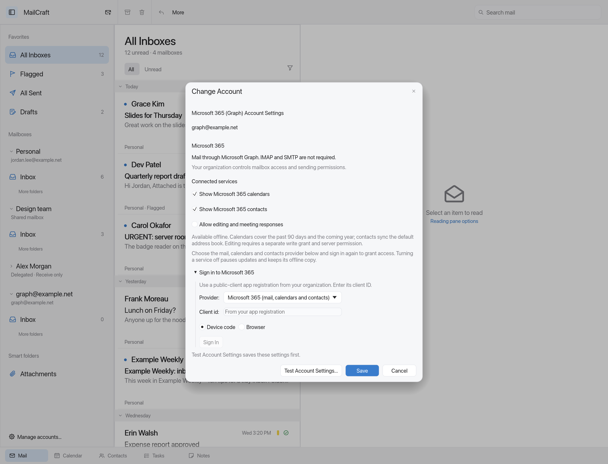
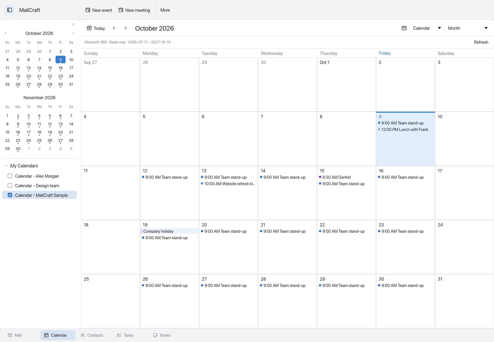
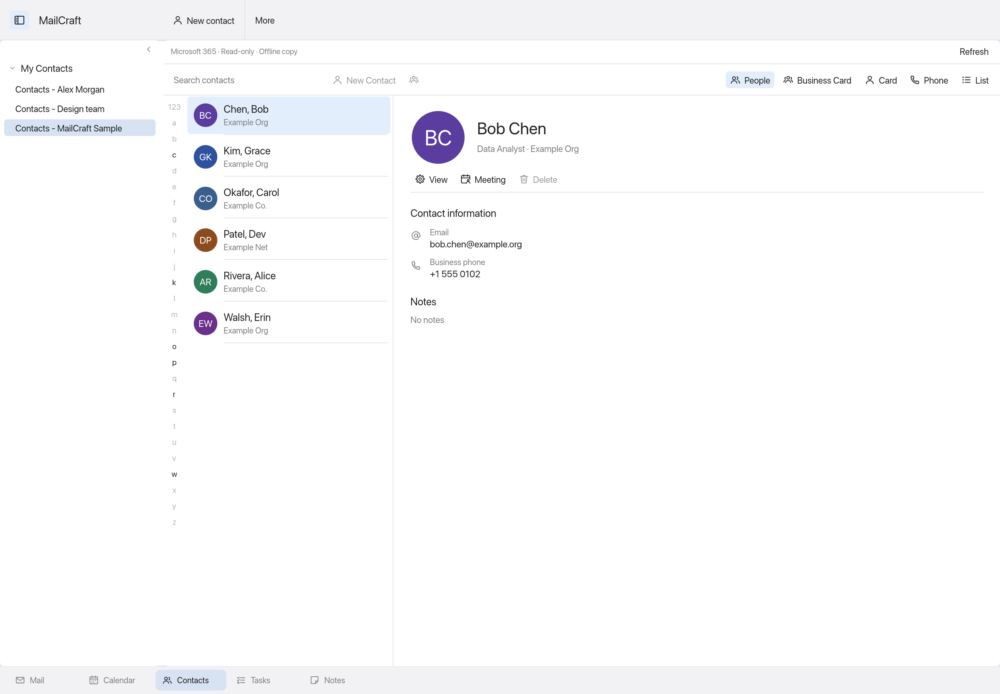

# Microsoft 365 mail, calendars and contacts

This is the first Microsoft Graph mail transport in MailCraft. It runs in the existing background
send/receive worker and works with the Apple, Outlook and Omarchy layouts. It has been verified with
synthetic local HTTP fixtures, **not a live Microsoft 365 tenant**.

## Setup

1. In Accounts, choose Add account, enter your work/school address and choose **Microsoft 365…**.
2. Register your own public-client application in Microsoft Entra. MailCraft does not ship a client ID
   or secret. Enable the public-client/device-code flow, or configure the loopback redirect used by
   browser sign-in (see [OAuth registration](../crates/net/data/README.md)). Your organization may require
   administrator approval for the registration or consent.
3. Choose the Microsoft 365 Graph provider, enter that registration's client ID and sign in.
   The Graph provider requests delegated `Mail.ReadWrite`, `Mail.ReadWrite.Shared`, `Mail.Send`,
   `Mail.Send.Shared`, and `offline_access` scopes for `https://graph.microsoft.com/`.
4. Finish setup and Get new mail. Graph uses HTTPS; IMAP and SMTP do not need to be enabled.

The current preset targets commercial Microsoft 365 work/school accounts (`organizations` authority),
not personal Outlook.com accounts or sovereign-cloud endpoints. Existing IMAP/SMTP accounts remain
available and are not automatically migrated. Their Outlook-resource OAuth grants cannot be reused for
Graph; sign in again through the Graph provider instead.

## Connected calendars and contacts

In a Graph account's settings, turn on **Show Microsoft 365 calendars** and/or **Show Microsoft 365 contacts**.
Choose **Microsoft 365 (mail, calendars and contacts)** in the sign-in provider list and sign in again.
This preset adds delegated `Calendars.Read.Shared` and `Contacts.Read.Shared` scopes; an older mail-only
sign-in does not grant these permissions. Your administrator may need to approve the new consent.
Mail-only accounts keep their existing provider and permissions.

After Get new mail (or the scheduled two-minute refresh), discovered calendars appear in Calendar.
Select the calendars you want to display. The default contacts folder appears in Contacts alongside
local address books. Connected folders belong to their original account and keep an offline copy.
The source strip identifies Microsoft 365 and offers Refresh. Unsynchronized organizer folders in a Graph account are labeled **(local)** to distinguish them from connected folders.

- Connected folders are **read-only by default**. Optional, server-confirmed editing and meeting responses are described below. Generic local editing, imports, deletion and moves into connected folders remain refused. Local folders remain editable; copying a connected item to a local folder makes a separate editable copy.
- Calendar snapshots cover the past **90 days through the coming year**. Graph supplies expanded
  recurring occurrences and exceptions, so they are not expanded twice by the local calendar engine.
  Canceled events disappear after a successful refresh. Dates outside this window are not cached.
- Default contacts include names, email addresses, phones, postal addresses, organization details,
  birthdays, categories and notes. Custom contact folders, photos and the organization directory are
  not synchronized yet.
- Access to calendars in linked/shared mailboxes depends on the actual server grants. Enable the
  services on that linked account and authorize it separately; the client does not discover permissions.
- Complete snapshots update existing items by remote ID and remove vanished items. A failed fetch,
  missing permission, malformed event or cancellation keeps the last successful offline copy. A calendar
  service error does not prevent the contact service from being attempted after mail sync succeeds.
- Turning off a service pauses refreshes and retains its offline copy. Removing the account removes its
  cached folders. Server refreshes survive local undo/redo. Connected snapshots do not fire duplicate
  local reminders; continue using your server calendar's reminders.

The Calendar API uses [calendarView](https://learn.microsoft.com/en-us/graph/api/calendar-list-calendarview?view=graph-rest-1.0)
for expanded occurrences; shared access follows Microsoft's [shared calendar permissions](https://learn.microsoft.com/en-us/graph/outlook-get-shared-events-calendars).
Snapshots use bounded full reads on each poll, rather than calendar/contact delta cursors or push.

## Editing and meeting responses

In Graph account settings, enable **Allow editing and meeting responses**. Select **Microsoft 365 (mail and organizer editing)** and sign in again. This separate preset requests `Calendars.ReadWrite.Shared` and `Contacts.ReadWrite.Shared`; enabling a local checkbox does not grant server access. Keep the calendar/contact service enabled and refresh its folders after signing in. Existing read-only grants remain available.

- In a connected calendar, open an event or its context menu and choose **Edit on Microsoft 365**. Supported fields are subject, location and timed-event start/end. The sheet provides date fields and a time picker in UTC. Command/API time values use ISO UTC or a numeric offset, including seconds. Occurrences and exceptions update only the selected occurrence; series masters and all-day date changes are refused. Meeting edits may send attendee updates, and setting a new location replaces the existing location list. Meeting bodies and online-meeting links are preserved.
- For a meeting where you are an attendee, choose **Respond on Microsoft 365**, then Accept, Tentative or Decline, with an optional message. **Send response** sends the response to the organizer. Declining can remove the event from the calendar.
- In a connected contact card, choose **Edit**. Supported fields are first/last name, company, job title, a single email address, mobile phone and notes. Other contact fields stay unchanged. Multiple email addresses must still be edited in Outlook; changing a single address preserves its existing server display name.
- Editing is exposed only when there is a cached server version, the editing option is enabled, and applicable calendar metadata permits it. Microsoft still checks the actual permissions; authorization failures are reported without changing cached data.

Changes are saved to a separate persistent proposal queue before network work starts. The cached item changes only after a confirmed server write and a successful refresh. Offline proposals wait for the next account sync. The connected source strip opens **Pending changes**, where proposals can be reviewed or discarded.

Conditional updates reject stale versions. Meeting responses first check that the current server version matches the version shown when the sheet opened. Failed proposals remain available; retries require explicit review of the current item and previous outcome in Outlook. A lost connection, server failure or interrupted app run holds the operation for review instead of automatically replaying it. Discarding a proposal does not undo a change Microsoft already accepted.

This is an initial write path: creation/deletion, full recurrence editing, meeting cancellation, broader contact fields and organizer management still need dedicated server-backed workflows. These writes have only been exercised against synthetic local fixtures, not a live tenant. Microsoft documents [event updates](https://learn.microsoft.com/en-us/graph/api/event-update?view=graph-rest-1.0), [contact updates](https://learn.microsoft.com/en-us/graph/api/contact-update?view=graph-rest-1.0) and [meeting responses](https://learn.microsoft.com/en-us/graph/api/event-accept?view=graph-rest-1.0).

Sheet previews: [event editor](images/microsoft365-edit-event.png), [contact editor](images/microsoft365-edit-contact.png), [meeting response](images/microsoft365-response.png), [pending proposals](images/microsoft365-pending.png). All use synthetic offline data.

## Shared and delegated mailboxes

Add your personal Graph account first, then choose Shared mailbox in Accounts. Select it as the
principal, enter the target mailbox address, and choose shared/delegated. Sign in separately as the
principal for that linked mailbox. Authorization settings can be inherited; access and refresh tokens
are never copied between accounts.

Receive-only is the default. **Allow sending from this mailbox** opts into using that mailbox's Graph
send endpoint. The client does not grant or discover Exchange permissions. This initial path expects
mailbox-wide access; folder-only delegation has not been implemented or validated.

Microsoft determines whether delegated messages are sent as the mailbox or on behalf of it, based on
the actual Exchange permissions. MailCraft does not offer a separate mode selector or promise Send As
from an unchecked local setting. Using the target mailbox's send endpoint also requires the applicable
Full Access grant. See Microsoft's [shared-folder access documentation](https://learn.microsoft.com/en-us/graph/outlook-share-messages-folders)
and [delegated sending documentation](https://learn.microsoft.com/en-us/graph/outlook-send-mail-from-other-user).

## Implemented

- Folder discovery, including child folders, and binding of well-known Inbox/Sent/Drafts/Trash/Junk/Archive roles.
- Per-folder incremental message sync, bounded pagination, persisted continuation state, and recovery from HTTP 410 expired state. New Graph accounts poll every two minutes by default; manual refresh is also available.
- Full MIME downloads, using existing attachment, offline storage and rendering paths.
- Read/unread and follow-up flags; moves between synchronized folders in the same mailbox; message deletion.
- MIME sending through Graph, including attachments and Bcc from the existing composer, up to a 3 MiB raw-message limit for this initial direct-send path.
- A local Sent copy while Microsoft's asynchronous send is filed; later sync adopts the server copy by Message-ID.
- OAuth refresh, redacted credentials, continuation-origin checks, and explicit authentication/permission/throttling errors.
- Protection for local read/flag/move edits made while a sync job is running.
- Uncertain submissions (for example a connection lost after sending) remain in the Outbox for manual review instead of being retried automatically. Check server Sent before reopening and resending them.

**All Sent** aggregates Sent Items folders from personal and linked accounts. Search stays within those
folders, and message actions retain the source mailbox. Individual Sent folders remain accessible.

## Still to implement

Calendar/contact creation and deletion, broader organizer editing, custom contact folders, mailbox permission discovery,
configurable Send As/on-behalf modes, Graph push notifications, server folder CRUD, message copy/upload,
server draft synchronization, large-attachment upload sessions, categories and broader Graph feature parity. Unsupported server folder
operations and copy uploads are refused; existing folders are discovered from the server. Drafts remain
local until sent. The initial mail download currently fetches the accessible folder history with safety
caps, rather than applying the IMAP/JMAP download-months preference.

EWS is not implemented. The Graph transport has no live-tenant or Linux runtime validation yet.
