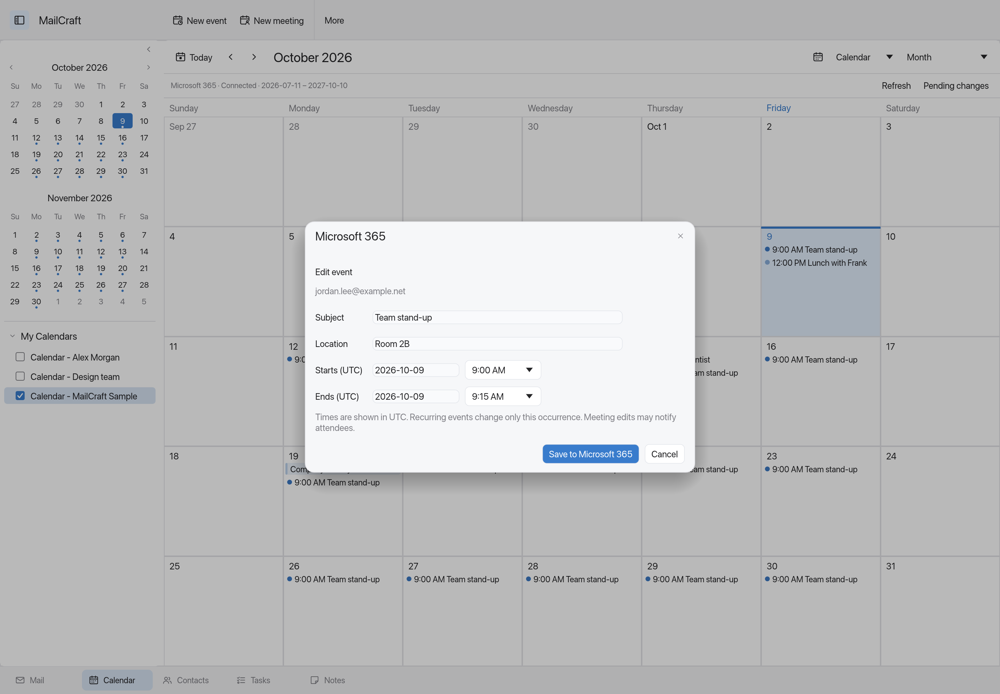

# October update: a more considered desktop, connected Microsoft 365

MailCraft Mac now brings its quieter desktop design across the inbox, compose window, settings, and organizer, alongside an initial Microsoft 365 Graph integration for personal, shared, and delegated mailboxes.

## A consistent interface

- Saved Apple, Outlook layout, and Omarchy/Tokyo Night profiles, with light/dark/system appearance and a custom color palette.
- Compact search and toolbar, restrained icons, lighter day markers, and a collapsible mailbox sidebar.
- A reading pane on the right with a draggable divider and native desktop window controls.
- Refined compose layout with visible sender and signature selection, plus consistently styled settings and account forms.
- All Inboxes and All Sent preserve each message's source mailbox. Calendar, Contacts, Tasks, and Notes remain available in the navigation bar.

## Microsoft 365, with explicit account permissions

The new Graph transport supports folder discovery, incremental mail synchronization, MIME messages and attachments, read/flag updates, moving and deleting messages, and sending. Shared and delegated mailboxes use their own authorization and default to receiving only; sending depends on the permissions granted by Microsoft 365.

Optional calendar and default-contact synchronization keeps an offline cache. A separate editing grant enables selected event and contact changes, and attendee Accept, Tentative, and Decline responses. Pending changes have a review screen, stale edits are rejected, and uncertain submissions are held for explicit review instead of automatically repeated.

Setup instructions and the supported scope are in [Microsoft 365 accounts](microsoft365.md).

## Preview scope

This is a pre-alpha source update. Microsoft 365 behavior has been tested with synthetic local fixtures, not a live tenant. Setup requires your own public-client application registration. Large attachment upload sessions, complete recurring-series editing, organizer creation/deletion, permission discovery, and full Outlook or Evolution feature parity remain future work.

Screenshots are generated from the app using synthetic data. This source release does not include a signed or notarized Mac download; see [building locally](releasing.md).
