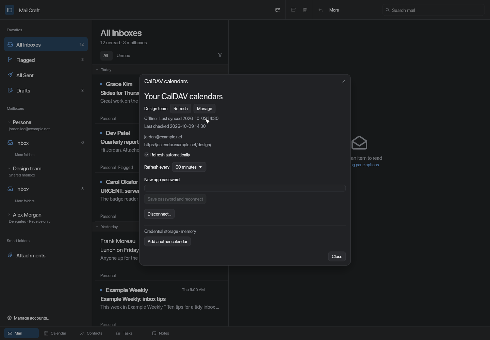
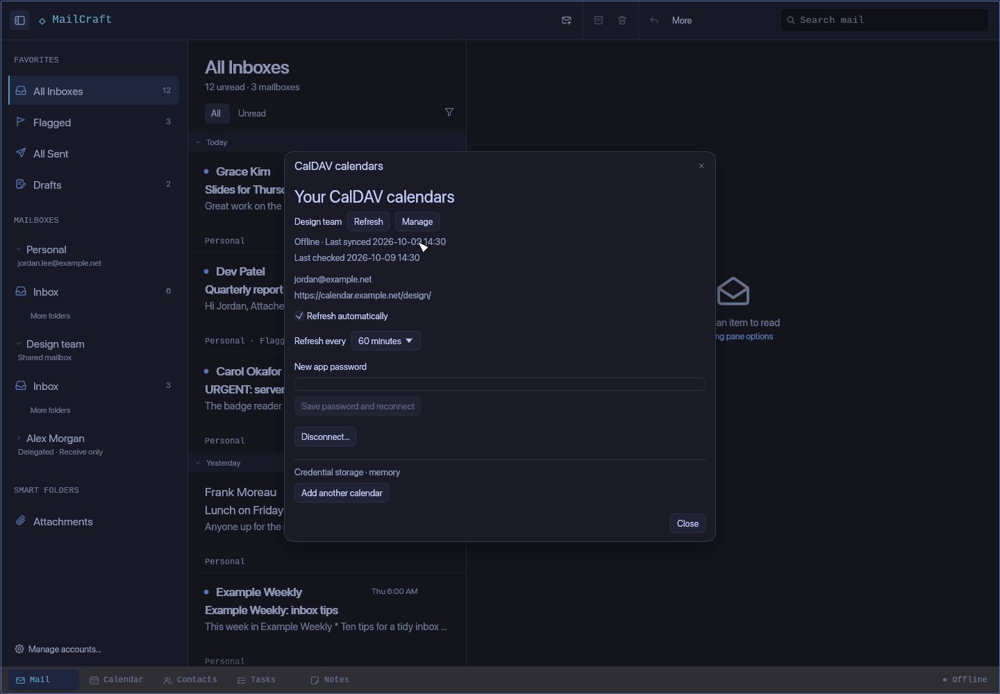

# Calendar connections, with offline access and recovery

MailCraft can now save CalDAV calendars alongside its local calendars and connected Microsoft 365
organizer. Calendars refresh in the background, keep their downloaded events available offline, and
have connection controls that follow the Apple styled and Omarchy interfaces.

## What changed

- Discover calendars from an HTTPS CalDAV endpoint and save an event calendar.
- Download a read-only snapshot covering 90 days back and one year ahead.
- Refresh manually or opt into scheduled updates while the desktop app is running.
- Choose the refresh interval, update an app password, and reconnect from **Manage**.
- See updating, offline and error states, with last successful sync and last-attempt times.
- Disconnect a source and remove its saved password while keeping appointments as an editable local calendar.

## Keeping cached events safe

Failed or incomplete downloads preserve the last good snapshot. Matching event identities keep their
local IDs across updates. Password changes invalidate older in-flight downloads, and removed sources
cannot receive late results. Synchronization and connection management stay outside editing Undo;
older Undo and Redo snapshots cannot reconnect a removed source or revert its connection settings.

Automatic refresh respects Work Offline and uses one download worker. Failed attempts wait for the
configured interval before retrying. The interval remains yours even when a calendar publishes a
different refresh hint. There is no refresh service while the app is closed.

Passwords are stored in the profile’s configured credential store, separately from calendar metadata
and mailbox journals. The connection panel identifies the store in use.

## Preview limits

This is a source update after the **0.2.0-alpha.1** preview; that release’s downloadable installers still
contain the earlier discovery-only implementation. No new binary release is included in this update.

CalDAV remains read-only. Servers must support calendar-query with expanded events; unsupported
recurrence or time-zone data leaves the cached calendar untouched and shows an error. HTTPS is
required, redirects and cross-origin links are rejected, and downloads are bounded. Automatic iCloud
shard discovery, server writes and meeting invitations remain future work.

Validation uses synthetic local fixtures and rendered app previews, without live provider accounts.
The complete quality gate covers formatting, linting, workspace tests, layering, assets, licences,
feature inventory and the browser build. See [CalDAV setup and connection management](caldav.md)
for instructions and the supported scope.
